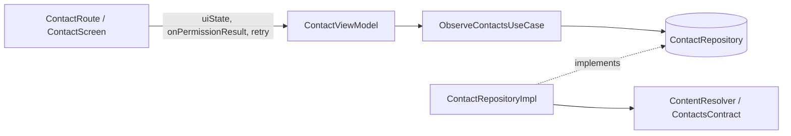

# ContentProviderContactCleanArch

Reads the device's contacts through Android's `ContactsContract` content provider, structured with
Clean Architecture (domain / data / presentation), Jetpack Compose, Hilt and Kotlin Flow.

## Architecture



| Layer          | Package          | Responsibility                                                         |
|----------------|------------------|------------------------------------------------------------------------|
| `domain`       | `domain.*`       | `Contact` model, `ContactRepository` interface, `ObserveContactsUseCase` |
| `data`         | `data.repository`| `ContactRepositoryImpl`: queries the provider, groups rows, observes changes |
| `presentation` | `presentation`   | `ContactViewModel` + sealed `ContactUiState`, Compose UI, permission flow |
| `di`           | `di`             | Hilt bindings (`@Binds` repository, `ContentResolver`, `@IoDispatcher`) |

## Behaviour worth knowing

- The phone table returns one row per number, so rows are **grouped by contact id**; a contact with
  several numbers appears once.
- Only contacts that have a phone row are listed.
- The list updates automatically when contacts change (`ContentObserver` wrapped in a `callbackFlow`).
- UI state is a single sealed `ContactUiState`: `Loading`, `PermissionRequired`, `Error`, `Success`.
- The `READ_CONTACTS` permission is re-checked on every resume, and a permanently denied permission
  sends the user to the app settings. If it is revoked at runtime, a `SecurityException` maps back to
  `PermissionRequired`.

## Tests

```
./gradlew testDebugUnitTest
```

- `ContactViewModelTest`: state transitions using a `FakeContactRepository` and Turbine.
- `ContactRepositoryImplTest`: cursor mapping, grouping, null handling, permission errors.

## Stack

Kotlin 2.0, Compose (BoM 2025.07), Hilt 2.51.1 with KSP, coroutines/Flow. All versions live in
`gradle/libs.versions.toml`.
